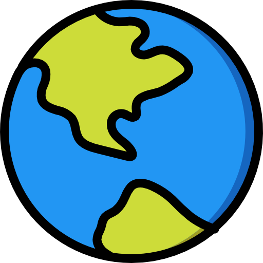

<div align="center">



# 🌍 Cambio Climático

**Un sitio web para entender, sin tecnicismos, el mayor desafío de nuestra época.**
Qué es, por qué pasa, qué consecuencias tiene y qué puedes hacer tú.

[]()
[]()
[]()
[](https://getbootstrap.com/)
[]()
[]()

</div>

---

## 🌡️ ¿De qué trata?

El cambio climático suele explicarse con gráficas y palabras difíciles. Este proyecto lo cuenta de otra forma: **en siete páginas claras, con imágenes y datos verificables**, pensadas para estudiantes, familias o cualquier persona curiosa, sin necesidad de ser científico.

Todo el contenido se apoya en fuentes de referencia como **IPCC, NASA, NOAA, UNFCCC y la ONU**.

### La experiencia: las "franjas de calentamiento"

El diseño se inspira en las famosas *warming stripes*: una franja de color por cada año entre 1850 y 2024, que va del azul frío al rojo intenso y muestra de un vistazo cómo se ha ido calentando el planeta. *(Las franjas del sitio son una serie ilustrativa con fines didácticos; para datos oficiales, consulta las fuentes de la página de Referencias.)*

---

## 🗺️ Qué vas a encontrar

| Página | Qué responde |
|---|---|
| **Inicio** (`index.html`) | Un vistazo general con datos clave (1,1 °C de aumento desde la era preindustrial, 421 ppm de CO₂, 20 cm de nivel del mar en el siglo XX, 97 % de consenso científico), carrusel de impactos y preguntas frecuentes. |
| **¿Qué es?** (`quees.html`) | Definición, origen y causas. |
| **¿Qué se ha hecho?** (`discusion.html`) | Acuerdos internacionales y movimientos ambientales. |
| **¿Qué debemos hacer?** (`debemoshacer.html`) | Acciones individuales y colectivas. |
| **Consecuencias** (`resultados.html`) | Efectos ambientales, sociales y económicos. |
| **Metodología** (`metodologia.html`) | Cómo se mide y se modela el clima. |
| **Referencias** (`referencias.html`) | Fuentes, instituciones y bases de datos para seguir investigando. |

---

## ✨ Detalles de diseño

- 🎨 **Modo claro y oscuro**, con transición circular al cambiar y preferencia recordada.
- 🌡️ **Franjas de calentamiento** de 1850 a 2024 como identidad visual.
- 🎬 **Cortina animada** entre páginas y títulos que aparecen palabra por palabra.
- 🔢 **Contadores animados** en los datos clave y contenido que aparece suavemente al hacer scroll.
- 📊 **Barra de progreso** de lectura en la parte superior.
- 🖼️ **Carrusel** de impactos: deshielo, incendios y sequías.
- ❓ **Preguntas frecuentes** desplegables.
- 🍔 **Menú a pantalla completa** en celulares.
- 🔊 **Sonido de clic** opcional, que se puede silenciar con el botón de altavoz.
- 📱 **Adaptable** a computador, tableta y celular.
- 🛟 **Contenido siempre visible:** si el JavaScript falla, el texto no se pierde.

---

## 🚀 Cómo verlo

Es un sitio estático: no hay que instalar nada.

```bash
git clone https://github.com/Sergio-Bustos/Cambio-Climatico
cd Cambio-Climatico
```

Abre `index.html` con doble clic, o usa un servidor local (recomendado):

```bash
python -m http.server 8000
# luego visita http://localhost:8000
```

> 💡 En VS Code también funciona la extensión **Live Server**.
> 🌐 Nota: Bootstrap y Bootstrap Icons se cargan desde una CDN, por lo que la primera vez necesitas conexión a internet.

---

## 🛠️ Tecnologías

| Tecnología | Uso |
|---|---|
| HTML5 | Estructura semántica de las siete páginas |
| CSS3 | Sistema de diseño propio dividido en 6 archivos temáticos |
| JavaScript | Franjas, animaciones, tema, menú y sonido (todo en `script.js`) |
| Bootstrap 5.3 | Rejilla responsive, carrusel y acordeón |
| Bootstrap Icons 1.11 | Iconografía |
| `localStorage` · `IntersectionObserver` · Web Audio | Recordar el tema, animar al hacer scroll y reproducir el clic |

---

## 📁 Estructura

```
Cambio-Climatico/
├── index.html · quees.html · discusion.html
├── debemoshacer.html · resultados.html
├── metodologia.html · referencias.html
├── script.js                 # Comportamiento e interactividad
├── styles.css                # Estilos generales
├── estilos-1-base.css        # Base y variables
├── estilos-2-menu-botones.css
├── estilos-3-hero-tarjetas.css
├── estilos-4-carrusel-bloques.css
├── estilos-5-footer-animaciones.css
├── estilos-6-herencia.css
├── *.jpg · icono.png         # Imágenes
├── click.wav                 # Sonido de clic
└── font_*.woff2              # Tipografías incluidas
```

---

## 🔬 Fuentes consultadas

Las páginas de **Referencias** reúnen, entre otras: [IPCC](https://www.ipcc.ch/) · [NASA Climate](https://climate.nasa.gov/) · [Climate.gov (NOAA)](https://www.climate.gov/) · [UNFCCC](https://unfccc.int/es) · [ONU – Acción por el clima](https://www.un.org/es/climatechange) · [Met Office Hadley Centre](https://weather.metoffice.gov.uk/climate/met-office-hadley-centre/index) · [Carbon Brief](https://www.carbonbrief.org/) · [World Weather Attribution](https://www.worldweatherattribution.org/).

---

<div align="center">

*"El cambio climático no es un problema del futuro: es el desafío del presente."*

Hecho con 💚 por **[Sergio Bustos](https://github.com/Sergio-Bustos)** como recurso educativo de acceso libre.

</div>
